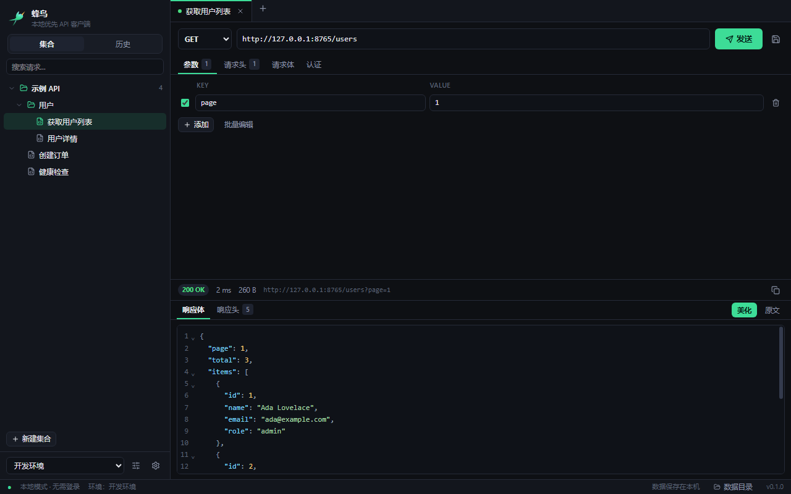
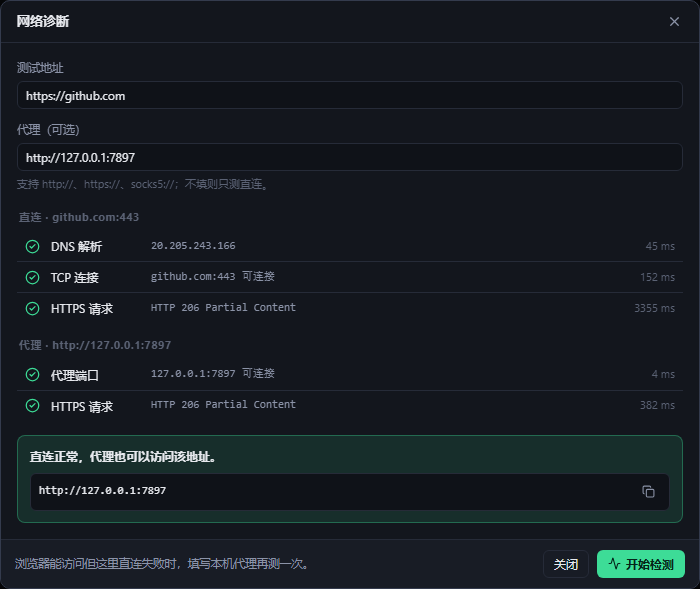

<p align="center">
  
</p>

<h1 align="center">蜂鸟 Hummingbird</h1>

<p align="center">
  本地优先、无需登录的桌面 API 调试客户端
  <br />
  <em>A local-first, account-free desktop API client.</em>
</p>

<p align="center">
  
  
  
  
  
  
</p>

<p align="center">
  
</p>

## 为什么做蜂鸟

Postman 很好用，但越来越多的时间花在了和调试无关的事情上：强制登录、云端同步、越来越重的界面，以及启动时漫长的等待。

蜂鸟想回到最朴素的需求：

- **打开就能用**：没有账号、没有引导、没有云端依赖
- **数据是我的**：集合、环境变量、历史记录全部保存在本机
- **足够轻**：Tauri 2 + 系统 WebView，安装包约 1.7 MB
- **少而顺手**：只保留每天都会用到的功能，并把它做顺

它不打算在功能数量上对标 Postman，而是把「本地、快速、干净」做到位。

## 功能

**请求**

- 常用 HTTP 方法、URL、查询参数、请求头（行级启用/禁用、批量编辑）
- 请求体：JSON、纯文本、Form URL Encoded、Multipart Form（当前仅文本字段）
- 认证：Bearer Token、Basic Auth、API Key（请求头或查询参数）
- 超时、重定向次数、忽略 TLS 证书、响应大小上限

**响应**

- 状态码、耗时、大小、最终 URL
- 响应头完整展示
- JSON 自动美化 / 原文切换，支持复制
- 超长响应自动截断，二进制响应给出提示

**cURL 互操作**

- 粘贴 curl 命令直接生成请求，支持 `-X`、`-H`、`-d`、`--data-raw`、`-F`、`-u`、`-G`、`--json` 等常用参数
- 当前请求一键复制为 cURL，历史记录中的每条请求也可以单独复制
- 导出时按当前环境替换 `{{变量}}`，生成可直接执行的命令

**组织**

- 集合 / 文件夹 / 请求树，支持新建、重命名、复制、删除、搜索
- 多标签页，未保存状态提示，切换标签自动保存
- 环境变量：`{{变量}}` 在 URL、参数、请求头、请求体、认证中生效；支持全局变量与环境覆盖
- 内置变量：`{{$timestamp}}`、`{{$isoTimestamp}}`、`{{$uuid}}`
- 发送历史：记录最近 500 次请求（可配置），一键回填
- 深色 / 浅色主题，可拖拽的请求/响应分栏

**网络诊断**

- 输入任意网址或域名，逐项检查 DNS 解析、TCP 端口、HTTP/HTTPS 请求
- 可选填代理地址，对比直连与代理结果，并给出一句话结论
- 完全在本地执行，不经过第三方服务

<p align="center">
  
</p>

**本地优先**

- 无账号、无云同步、无遥测
- 数据以 JSON 文件保存在本机（见[数据与隐私](#数据与隐私)）
- 原子写入 + `.bak` 备份 + 每日快照，避免异常退出损坏数据

## 快速开始

### 下载安装

从 [Releases](https://github.com/kusanyao/hummingbird/releases/latest) 下载：

- **安装版**：`Hummingbird_0.2.0_x64-setup.exe`
- **免安装版**：`Hummingbird_0.2.0_x64_portable.exe`，双击即可运行
- **校验文件**：`SHA256SUMS.txt`

> 目前主要在 Windows 10/11 上开发和验证，macOS / Linux 尚未测试。
>
> 程序暂未签名，SmartScreen 可能提示“未知发布者”，选择「更多信息 → 仍要运行」即可。

### 从源码运行

环境要求：

| 依赖 | 说明 |
| --- | --- |
| Node.js | 18+ |
| Rust | MSVC 工具链 `stable-x86_64-pc-windows-msvc` |
| Visual Studio Build Tools | 2022，勾选「使用 C++ 的桌面开发」 |
| WebView2 Runtime | Windows 10/11 通常已内置 |

```bash
# 克隆仓库后进入项目目录
npm install
npm run tauri dev
```

构建安装包：

```bash
npm run tauri build
```

产物：

```text
src-tauri/target/release/hummingbird.exe
src-tauri/target/release/bundle/nsis/Hummingbird_0.2.0_x64-setup.exe
```

> **Windows 构建提示**
>
> - 请在 PowerShell 中执行 `cargo` / `npm run tauri`，Git Bash 自带的 `link.exe` 可能干扰 MSVC 工具链。
> - `rust-toolchain.toml` 已固定 MSVC 工具链。
> - `.cargo/config.toml` 配置了 rsproxy 镜像以加速国内下载；如在海外，删除该文件即可改用 crates.io。
> - 图标由 `design/logo-square.svg` 生成，修改后执行 `npm run icons`。

## 快捷键

| 快捷键 | 功能 |
| --- | --- |
| `Ctrl + Enter` | 发送当前请求 |
| `Ctrl + S` | 保存（草稿会弹出保存对话框） |
| `Ctrl + T` | 新建标签页 |
| `Ctrl + W` | 关闭当前标签页 |
| `Ctrl + L` | 聚焦 URL 输入框 |

## 数据与隐私

所有数据都在本机，不上传任何服务器：

```text
%APPDATA%\dev.hummingbird.app\
  settings.json          # 应用设置
  environments.json      # 环境与全局变量
  history.json           # 发送历史
  collections\<id>.json  # 每个集合一个文件
  backups\<日期>\        # 每日快照
```

- 写入采用「临时文件 + 重命名」，并保留上一版本的 `.bak`
- 启动时每天自动生成一次快照，最多保留 10 份
- 应用内可通过「设置 → 打开数据目录」直接查看和备份

## 技术栈与结构

- **桌面壳**：Tauri 2（Rust）
- **前端**：React 19 + TypeScript + Vite
- **状态**：Zustand
- **编辑器**：CodeMirror 6
- **样式**：Tailwind CSS v4
- **HTTP**：reqwest（Windows 使用系统原生 Schannel TLS）
- **存储**：本地 JSON 文件（原子写入）

```text
hummingbird/
├─ src/                      # React 前端
│  ├─ components/            # 侧栏、请求区、响应区、弹窗
│  ├─ stores/                # 工作区、标签页、UI 状态
│  ├─ lib/ipc.ts             # 类型化 invoke 封装
│  └─ types.ts               # 与 Rust 模型对应的类型
├─ src-tauri/
│  └─ src/
│     ├─ models.rs           # 数据模型
│     ├─ storage.rs          # JSON 持久化、原子写入、备份
│     ├─ http.rs             # 请求构建与执行、变量插值
│     └─ commands.rs         # IPC 命令
├─ design/                   # 图标源文件与生成脚本
├─ docs/                     # README 截图
└─ .cargo/config.toml        # 国内 crates 镜像（可删除）
```

请求链路：

```text
React → invoke(command) → commands.rs → http.rs(reqwest) → 本地 JSON 持久化
```

浏览器端不直接发请求，因此不受 CORS 限制，也可以访问内网接口和自签名 HTTPS 服务。

## 路线图

- [x] 请求构建、发送、响应查看
- [x] 集合 / 文件夹 / 请求树
- [x] 环境变量、全局变量、内置变量
- [x] 发送历史、多标签页、自动保存
- [x] 深色 / 浅色主题
- [ ] 导入 Postman 集合与环境
- [ ] Multipart 文件上传
- [ ] 前置 / 后置脚本与断言
- [ ] 集合批量运行（Collection Runner）
- [ ] Cookie 管理与代理设置
- [ ] 便携模式（自定义数据目录）
- [ ] macOS / Linux 构建与验证

欢迎通过 Issue 讨论优先级。

## 已知限制

- 暂时不支持上传文件（Multipart 仅文本字段）
- 暂时没有脚本、断言、集合批量运行
- 暂时不支持 Postman 导入/导出
- 没有云同步与团队协作（这是刻意设计，不是待办）

## 参与贡献

欢迎 Issue 和 Pull Request。

```bash
# 提交前建议执行
npm run build          # TypeScript + 前端构建
cd src-tauri
cargo test             # Rust 单元测试与本地 HTTP 集成测试
cargo fmt
```

- 前端遵循 TypeScript strict
- Rust 代码保持 `cargo fmt` / `clippy` 干净
- 新增行为请尽量补充测试
- 提交 PR 时说明动机、改动点和验证方式

## License

[MIT](LICENSE) © 2026 KSY

---

<details>
<summary>English</summary>

**Hummingbird** is a local-first, account-free API client for Windows, built with Tauri 2, React 19 and Rust.

- No login, no cloud sync, no telemetry — everything is stored locally as JSON files
- Requests are executed by the Rust backend, so there are no CORS restrictions
- Collections, folders, environments with `{{variables}}`, history, tabs and autosave
- Import curl commands and copy any request back to a runnable curl command
- Small footprint: the NSIS installer is about 1.7 MB

Build from source with `npm install && npm run tauri dev`. See the Chinese sections above for details.

</details>
